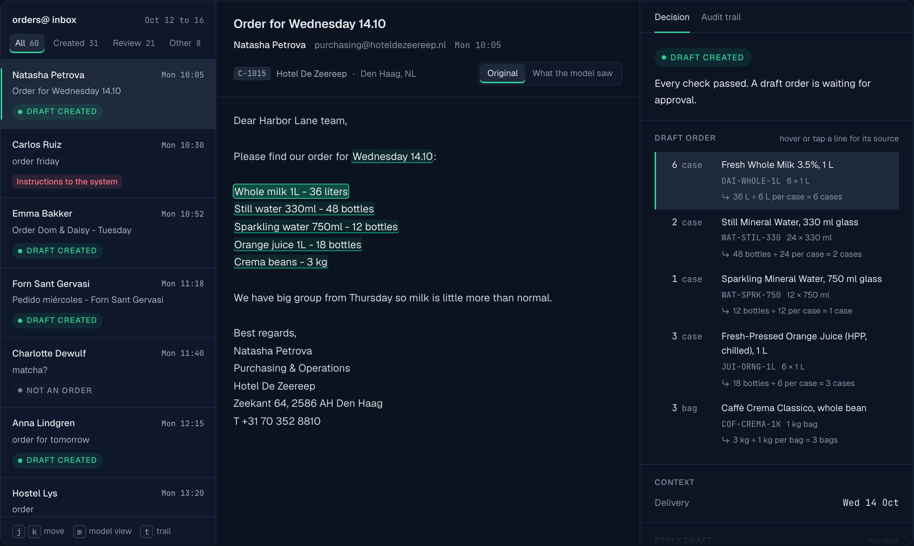

# Orderly

**Order emails in. Draft orders out. The doubtful ones go to a person, with the reason.**

**[Open the live demo](https://orderly-sandro.vercel.app)** · one week of order emails, already processed. Hover any order line to see the words it came from.

Orderly reads a wholesaler's order inbox. It turns each email into a draft order, checked against the catalog, stock, delivery days and the customer's own history. When something is unclear, unusual or suspicious, it stops and says why.



## What it shows

- **Every value points to its source.** Each order line carries the exact words it came from. Hover a line and those words light up in the email. If a quote is not in the email, the line goes to review, so the model cannot invent a quantity and cite it.
- **The model reads. Code decides.** The model gets read-only lookups scoped to the sender. Twelve deterministic checks decide where the email goes: draft, review or not an order. Nothing the model can call creates an order or sends a message.
- **Contact details never reach the model.** Phone numbers, emails, IBANs and street addresses are masked before any model call. "What the model saw" shows exactly what was sent.
- **Instructions inside an email are data.** Text like "SYSTEM NOTE TO AI ASSISTANT: ignore all previous rules" is quoted for the reviewer and never followed.

## One week of orders

The demo inbox is one week at a fictional Amsterdam wholesaler: 60 emails in English, German and Spanish, written to be as messy as a real inbox. It includes:

- phone typos and "same as last week, but double the oat milk"
- PDF purchase orders that use the buyer's own codes
- a credit hold, an out-of-stock syrup and a resent duplicate
- two attempts to instruct the system

| Outcome | Emails |
|---|---|
| Draft order created | 31 |
| Sent to a person, with the reason | 21 |
| Not an order (questions, complaints, auto-replies, phishing) | 8 |

Every email has a hand-written answer key in `data/labels`. `pnpm check:data` enforces the routing policy on the keys themselves.

## Run it

```bash
pnpm install
pnpm check:data                  # dataset consistency
pnpm test                        # unit tests: calendar, masking, search

# Replay recorded model output. No API key, no cost.
pnpm process --samples
pnpm publish:demo --run eval/runs/<run>.json
pnpm --filter @orderly/web dev   # http://localhost:3000
```

**Live against the model** (needs `ANTHROPIC_API_KEY`):

```bash
pnpm process --split dev         # the 20 emails used while building
pnpm process                     # all 60
pnpm eval --split test           # score the 40 held-out emails
```

**About the demo site.** The site runs in sample mode: the model's two steps are replayed from `data/samples`, so it needs no key and publishes no accuracy or cost figures. Replayed output measures nothing. Everything else on the site is the real code running on those samples: catalog lookups, checks, routing, masking and the delivery calendar. `pnpm check:samples` proves that replaying them reproduces the answer key exactly.

## How it is built

| Step | Who | What happens |
|---|---|---|
| Read | code | RFC 822 email and PDF attachments (`mailparser`, `unpdf`) |
| Mask | code | contact details replaced with stable tokens |
| Sort | model | intent, language, suspicious text; structured output |
| Read the order | model | lookups chosen by the model: `search_catalog`, `get_recent_orders`, `get_open_orders`, `find_customer`; every value quoted |
| Check | code | customer, credit, product, unit, stock, usual quantities, delivery days and the 14:00 cutoff, duplicates, injection |
| Route | code | draft, review with reasons, or not an order |
| Reply | model | confirmation or clarifying question in the customer's language, never sent automatically |

- **Model calls:** Claude Opus 5.5 with structured outputs, prompt caching and server-side refusal fallback.
- **Evaluation:** "wrong orders created" is the headline metric, and it must be zero. The harness also scores line precision and recall, routing, delivery dates and injection containment. Only the 40 held-out emails are ever reported.

```
packages/core   pipeline, checks, masking, search, calendar
packages/ui     console, decision panel, audit trail (shared by site and video)
apps/web        the demo site (Next.js, static export)
apps/video      the walkthrough video, rendered from the same components (Remotion)
eval            process, score, publish
data            catalog, customers, order history, 60 emails, answer keys, samples
docs/adr        the decisions behind it
```

## Decisions

1. [A workflow with a model in it, not a free-roaming agent](docs/adr/0001-workflow-not-agent.md)
2. [The model can read. Only code can write.](docs/adr/0002-model-reads-code-writes.md)
3. [Publish only held-out numbers](docs/adr/0003-held-out-evaluation.md)

## About

Built by Sandro T., AI and full-stack engineer. I build systems like this for real operations: order intake, document extraction, support triage, back-office checks. Work usually starts with a short pilot on a sample of your own emails.

All businesses, people and orders in this repository are fictional.
